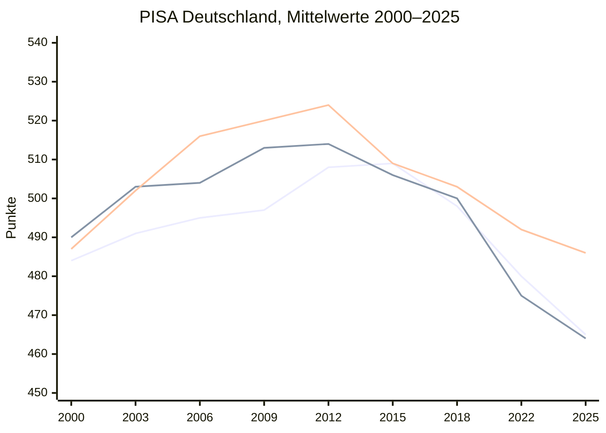
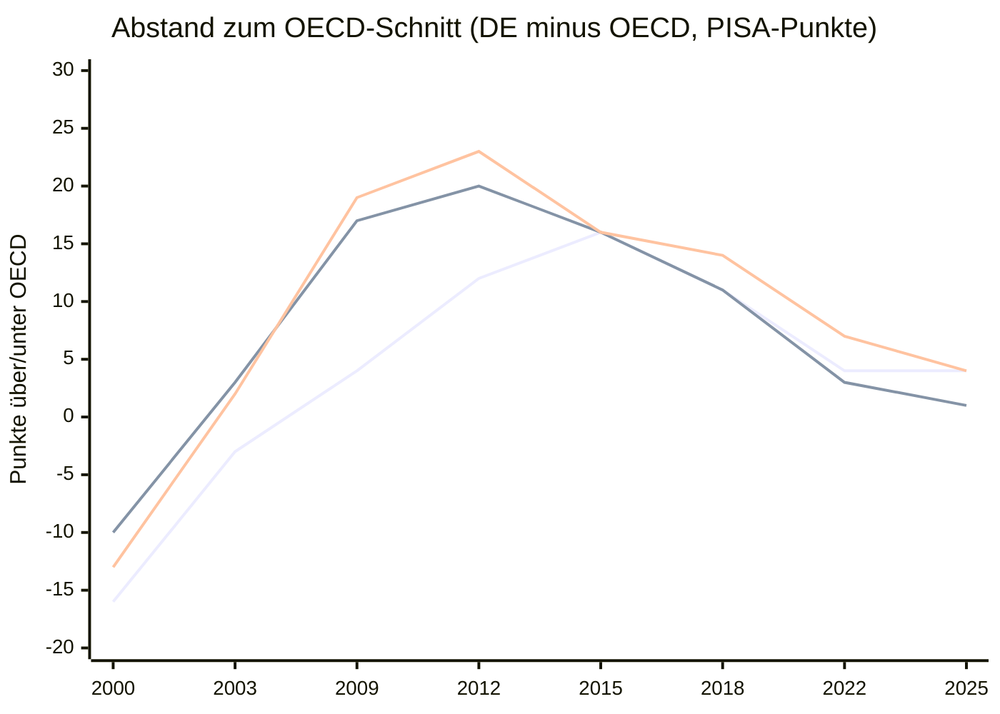

# Episode: PISA-Schock 2026 — Ist Deutschland noch ein Bildungsland?

**Podcast:** Der Akademiker und der Hauptschüler
**Arbeitstitel:** „Jeder Dritte kann nicht richtig lesen — und Herkunft schlägt Zuwanderung“
**Stand:** 14. September 2026
**Anlass:** Veröffentlichung PISA 2025 am 8.9.2026 — größte Bildungsgeschichte des Quartals
**Geschätzte Länge:** ca. 40–45 Minuten
**Serie:** Bildung 2026 (Folge 1 von 2) — siehe [`11_serie_bildung_akadaemlich_pisa.md`](11_serie_bildung_akadaemlich_pisa.md)

**Belastbarkeits-Legende:**

- **[belegt]** — gegen Primärquelle geprüft
- **[eigene Einordnung]** — Moderationslesart, keine externe Zahl
- **[unsicher]** — auf Sendung als Schätzung kennzeichnen

---

## Roter Faden (vor der Aufnahme lesen)

Eine Leitfrage, drei Bewegungen. Kein Länder-Ranking-Tourismus, keine Schulreform-Wunschliste.

### Die Leitfrage

> **Wenn 15-Jährige in Deutschland so schlecht abschneiden wie nie seit PISA 2000 — und die Herkunftskluft größer ist als je zuvor: Ist das ein Leistungsproblem, ein Gerechtigkeitsproblem, oder dasselbe Problem mit zwei Namen?**

### Drei Bewegungen

| # | Bewegung | Kern | Blöcke |
| --- | --- | --- | --- |
| **I** | Schock, Karte, Zeitreihe | Historisches Tief, OECD-Schnitt, und: der Club ist mitgefallen — Deutschland extra steiler seit 2015. | Hook, Zahlenkarte, Zeitreihe |
| **II** | Die eigentliche Kluft | Herkunft, nicht Migration. UNICEF Platz 34. ifo 16,9 vs. 80,3. Lesen als KI-Risiko. | Herkunft, Lesen/Social Media |
| **III** | Was nach 25 Jahren Diagnosen fehlt | Die Rezepte sind bekannt. Startchancen gibt es. Die Fläche fehlt. Was heißt das für Ausbildung, Studium, Betrieb? | Reformen, Format-Brücke, Outro |

### Ein Satz, der die Folge trägt

> Deutschland ist nicht „abgestürzt unter die OECD“. Der ganze Club liest und rechnet schlechter. Deutschland hat zusätzlich den Vorsprung von 2012 verspielt und liegt wieder auf dem Schnitt — mit Rekord-Sockel und Rekord-Herkunftskluft. Das ist kein PISA-Unfall. Das ist ein Sortiersystem, das seine eigenen Versprechen nicht mehr hält.

---

## Kernthese

> PISA 2025 (Erhebung März–Mai 2025, Veröffentlichung 8.9.2026) liefert die niedrigsten Kompetenzwerte seit Beginn der Studien vor 25 Jahren — in Naturwissenschaften, Lesen **und** Mathematik. Gleichzeitig liegt Deutschland in allen drei Bereichen nur noch im OECD-Durchschnitt. Das ist kein Widerspruch: Der OECD-Raum ist mitgefallen (Lesen −28, Mathe −22 Punkte 2015–2025). Deutschland ist trotzdem **nicht nur** mit der Welle gesunken. Der Rückgang fällt laut DIPF/ZIB hierzulande **besonders deutlich** aus — aus einer Lage klar über dem Schnitt (Peak 2012) zurück auf den Schnitt. Dramatisch bleibt der Sockel: rund ein Drittel verfehlt in Lesen und Mathe das Mindestniveau; die Herkunftskluft ist so stark wie nie seit 2000. **[belegt]**

---

## Host-Dynamik

| Rolle | Funktion |
| --- | --- |
| **Dennis** | Zahlenkarte, Herkunft vs. Migration, UNICEF/ifo, Greiff/Schleicher, Startchancen-Einordnung. Hält die Folge vom Ranking-Voyeurismus fern. |
| **Martin** | Was heißt „kein Prozentrechnen, keine E-Mail verstehen“ im Betrieb, in der Ausbildung, im Recruiting? Wer kommt 2026 als Azubi an — und mit welchen Lücken? |

*Vor der Aufnahme klären:* Wer von euch hat selbst PISA-2000 als Schüler:in miterlebt? Eine biografische Brücke reicht, keine Lebensbeichte.

---

## Diskussionsaufbau (nur Gerüst)

1. Hook: „Schock“ vs. Greiff — historisch schlecht, aber OECD-Schnitt.
2. Zahlenkarte 2025, dann **Zeitreihe**: absolut vs. relativ zum OECD-Raum.
3. Herkunftskluft: Greiff, UNICEF, ifo Chancenmonitor.
4. Lesen, „hasty readers“, Social Media, Streeck — mit dem OECD-Caveat.
5. Was andere besser machen — knapp, als Kontrast, nicht als Folienvortrag.
6. Reformen, die es schon gibt: Startchancen 20 Mrd., Prien vs. Greiff.
7. Brücke ins Format: Schule → Ausbildung/Studium → *Akadämlich*.
8. Outro + Community-Frage.

---

## Begriffsklärung, einmal am Anfang

| Formulierung | Was sie bedeutet | Falle |
| --- | --- | --- |
| **PISA 2025** | Erhebungszyklus, Hauptdomäne Naturwissenschaften | Nicht als „veraltet“ abtun — Standard-Lag |
| **PISA-Studie 2026** | Medienframe wegen Veröffentlichung 8.9.2026 | Einmal auflösen, dann den Titel behalten dürfen |
| **Kompetenzstufe II** | Mindestniveau für einfache Alltagsanforderungen | Nicht „Analphabetismus“ sagen |
| **20–30 PISA-Punkte** | grob ein Lernjahr **[belegt, ZDF/Greiff]** | Nur als Größenordnung |
| **„hasty readers“** | OECD-Begriff: Texte überfliegen, falsch antworten | Kein Beweis, dass TikTok die Ursache ist |

---

## Zahlenkarte (Herzstück — vor Aufnahme an die Wand)

### Die drei Domänen **[belegt, BMBFSFJ / ZIB / tagesschau, 8.9.2026]**

| Bereich | DE | OECD | EU | Sockel ohne Basiskompetenz | Spitze (Stufen V/VI) |
| --- | --- | --- | --- | --- | --- |
| Naturwissenschaften (Hauptdomäne) | **486** | 482 | 476 | ~1/4 | <10 % |
| Lesen | **465** | 461 | 451 | ~1/3 | <10 %, rückläufig |
| Mathematik | **464** | 463 | 460 | ~1/3 | <10 %, rückläufig |
| Modellbasiertes Problemlösen (neu, „Lernen in der digitalen Welt“) | **498** | 500 | 492 | ~1/4 niedrig **und** ~1/4 hoch | anderes Muster |

Mathe 2015: noch **>500**. Heute 464. Naturwissenschaften vor gut zehn Jahren deutlich über 500, heute 486.

Stichprobe Deutschland: **6.659** 15-Jährige, ~250 Schulen, 31.3.–23.5.2025. Weltweit >760.000 aus 91 Staaten. **61 %** nicht-gymnasiale Schularten, **36 %** Gymnasium. **[belegt, ZIB-Kompakt]**

### Drei Sätze, die die Karte tragen

- Rund **ein Fünftel** verfehlt die Basiskompetenz in **allen drei** Bereichen. Das sind keine Gedichtinterpretationen — das ist: E-Mail verstehen, Rabatt rechnen, Grafik lesen. **[belegt, Greiff / tagesschau]**
- Der Anteil kompetenzstarker Jugendlicher liegt in allen drei klassischen Domänen **unter 10 %**. Die Mitte sinkt, die Spitze schrumpft, der Sockel wächst.
- Digitale Welt ist die Ausnahme: polarisiert, nicht nur abgestürzt. Gut für die Diskussion „Handy macht dumm“ — so einfach ist es nicht.

---

## Zeitreihe: Absolut tief — relativ nur noch Durchschnitt

Die Vermutung „alle sind schlechter geworden, Deutschland nicht extra“ ist **halb richtig**. Der OECD-Raum ist klar eingebrochen. Deutschland ist mitgefallen — und hat zusätzlich den Vorsprung verspielt, den es nach 2000 aufgebaut hatte.

Offizielle Grafiken, die ihr für Shownotes/Video nutzen könnt (nicht nachzeichnen müssen):

- **OECD Country Note Deutschland, Figure 2** — Trendkurven Wissenschaft/Mathe/Lesen, weiße Punkte = nicht signifikant anders als 2025. Interaktiv: [OECD Performance Trends Dashboard](https://www.oecd.org/en/data/dashboards/pisa-education-and-skills/performance-trends.html)
- **ZIB PISA-Kompakt Sonderausgabe 09/2026** — eine Abbildung mit Linien **Deutschland / OECD / EU** über alle Zyklen seit 2000 (CC BY-SA 4.0)

### 1. Deutschland absolut, 2000–2025 **[belegt]**

Deutsche Mittelwerte (OECD-Bände 2000–2022, zusammengestellt; 2025: BMBFSFJ/ZIB/DIPF):

| Zyklus | Lesen DE | Mathe DE | Naturwiss. DE |
| --- | ---: | ---: | ---: |
| 2000 | 484 | 490 | 487 |
| 2003 | 491 | 503 | 502 |
| 2006 | 495 | 504 | 516 |
| 2009 | 497 | 513 | 520 |
| 2012 **Peak** | **508** | **514** | **524** |
| 2015 | 509 | 506 | 509 |
| 2018 | 498 | 500 | 503 |
| 2022 | 480 | 475 | 492 |
| **2025** | **465** | **464** | **486** |

Drei Phasen, nicht eine Gerade:

1. **2000–2012 Aufstieg** nach dem ersten Schock — vor allem Naturwissenschaften und Mathe.
2. **2015–2022 Bruch** — der Trend war schon vor Corona negativ (Destatis zu PISA 2022); 2022 dann der große Satz nach unten.
3. **2022–2025 Nachgeben** — Lesen und Mathe weiter runter, Naturwissenschaften statistisch etwa auf 2022-Niveau. **[belegt, OECD Country Note]**

### 2. Der OECD-Raum ist mitgefallen **[belegt, OECD 2025]**

| Domäne | OECD 2015 → 2025 | Δ OECD | grob in Lernjahren |
| --- | --- | ---: | --- |
| Lesen | 489 → 461 | **−28** | ~1,5 Jahre |
| Mathematik | 485 → 463 | **−22** | ~1 Jahr |
| Naturwissenschaften | (leichter Rückgang) | **−7** | unter einem halben Jahr |

56 von 74 vergleichbaren Systemen: signifikanter Leseverlust 2018–2025. Nicht-OECD: Lesen −16, Mathe −8. Wissenschaft außerhalb der OECD weitgehend stabil. **[belegt, OECD Insights / Pressemitteilung 8.9.2026]**

2022–2025, also der letzte Schritt **[belegt, OECD Insights-Tabellen]:**

| | Lesen Δ 2022–25 | Mathe Δ 2022–25 | Naturwiss. 2022–25 |
| --- | ---: | ---: | --- |
| Deutschland | **−15** (480→465) | **−11** (475→464) | −7 / laut Country Note „about the same“ (492→486) |
| OECD-Schnitt | **−14** | **−9** | weitgehend stabil |

Im letzten Zyklus ist Deutschland **kein Ausreißer nach unten**. Es rutscht ungefähr mit dem Club.

### 3. Relativ: der Vorsprung ist weg **[belegt]**

Abstand Deutschland minus OECD-Schnitt (positive Zahl = besser als der Club). OECD-Jahreswerte 2000–2022 aus den jeweiligen OECD-Bänden; 2025 aus BMBFSFJ. 2006 fehlt in mehreren OECD-Durchschnittsreihen — deshalb ausgelassen.

| Zyklus | Lesen DE−OECD | Mathe DE−OECD | Naturwiss. DE−OECD |
| --- | ---: | ---: | ---: |
| 2000 | 484−500 = **−16** | 490−500 = **−10** | 487−500 = **−13** |
| 2003 | 491−494 = **−3** | 503−500 = **+3** | 502−500 = **+2** |
| 2009 | 497−493 = **+4** | 513−496 = **+17** | 520−501 = **+19** |
| 2012 Peak | 508−496 = **+12** | 514−494 = **+20** | 524−501 = **+23** |
| 2015 | 509−493 = **+16** | 506−490 = **+16** | 509−493 = **+16** |
| 2018 | 498−487 = **+11** | 500−489 = **+11** | 503−489 = **+14** |
| 2022 | 480−476 = **+4** | 475−472 = **+3** | 492−485 = **+7** |
| **2025** | 465−461 = **+4** | 464−463 = **+1** | 486−482 = **+4** |

DIPF/ZIB, 8.9.2026: In den Naturwissenschaften liegt Deutschland **erstmals seit 2006 nicht mehr über** dem OECD-Durchschnitt. Die +4 Punkte 2025 sind statistisch „nah am Schnitt“, kein Vorsprung. **[belegt]**

*Lesehilfe:* Alles über 0 = Deutschland besser als der Club. Die Kurven laufen nach 2012/2015 zurück zur Nulllinie — nicht, weil der Club besser geworden wäre, sondern weil Deutschland den Vorsprung verloren hat, während beide sanken.

### 4. Der Satz für die Sendung

Zwei Zahlenpaare, nicht eine Moral:

| Blick | Befund 2015–2025 |
| --- | --- |
| **International** | OECD Lesen −28, Mathe −22. Ja: fast alle sind schlechter. |
| **Deutschland extra** | DE Lesen 509→465 (**−44**), Mathe 506→464 (**−42**), Naturwiss. 509→486 (**−23**). Das ist **mehr** als der OECD-Verlust. DIPF: Rückgang „besonders deutlich“. |
| **Letzter Zyklus** | 2022–2025: DE ≈ OECD. Kein Sonderabsturz mehr, sondern Mitgehen. |
| **Position** | Vom klaren Plus (2012: bis +23 in Naturwiss.) auf den Schnitt. Relativ nicht „abgestürzt unter die Welt“ — absolut historisches Tief, **unter** PISA 2000. |

Wenn ihr 20–30 Punkte ≈ 1 Lernjahr setzt: Deutschland hat in Lesen seit 2015 grob **zwei Lernjahre** verloren, der OECD-Raum **eineinhalb**. Die Extra-Lücke sitzt vor allem in der Dekade 2015–2022, nicht erst in der Schlagzeile vom 8.9.2026.

**Moderationsfalle:** Den OECD-Verfall nicht als Entschuldigung vorlesen („die anderen auch“). Und den deutschen Extra-Verlust nicht als Alleinstellung („nur wir“). Beides ist falsch.

**Diskussions-Hook:**

> „Wenn der ganze Club schlechter liest — sind wir dann ‚nur durchschnittlich schlecht‘? Oder ist der verlorene Vorsprung nach 2012 die eigentliche deutsche Geschichte?“

**OECD-Caveat, einmal sagen:** Der OECD-Durchschnitt eines Jahres ist nicht immer dieselbe Ländergruppe wie der OECD-Trendwert (konstante Teilnehmer). Deshalb 2015-Lesen einmal als 493 (Jahres-Schnitt) und einmal als 489 (Trendwert) auftaucht. Die Richtung ändert das nicht. **[belegt]**

---

## Hook-Hinweise (~5 Min.)

**Einstiegsbild, nicht Ranking:** Eine 15-Jährige soll eine längere E-Mail verstehen und herausfinden, was von ihr verlangt wird. Jede dritte in Deutschland scheitert auf diesem Niveau beim Lesen. Jede dritte beim Rechnen. **[belegt]**

**Der Begriff, den Greiff nicht will:** Samuel Greiff (TUM, deutscher PISA-Leiter): „Ich möchte nicht bewerten, ob wir jetzt vom nächsten PISA-Schock sprechen müssten. Aber ich kann sagen, dass wir historisch niedrige Kompetenzstände sehen.“ **[belegt, DW]** Der erste PISA-Schock 2000 löste Reformen aus. Diesmal liegen die Werte **unter** dem Niveau von 2000.

**Diskussions-Hook:**

> „Wenn der Studienleiter das Wort Schock verweigert — ist das wissenschaftliche Vorsicht, oder die Angst, 25 Jahre Reformrhetorik als gescheitert zu erklären?“

**Übergang:** Erst die Karte, dann die Kluft. Sonst bleibt es bei „wir sind schlechter geworden“.

---

## Block 1 — Was die Zahlen nicht sagen (~8 Min.)

Hinweise, keine Ableseliste:

- **OECD-Schnitt ist kein Trost.** Relativ zum Club der Reichen mittelmäßig, relativ zu uns selbst historisch schlecht. Die Zeitreihe oben zeigt: 2012 lagen wir klar drüber, 2025 drauf.
- **Internationaler Leseverfall** (OECD: −28 Punkte 2015–2025) — Deutschland fällt in einem fallenden Feld, aber **steiler** (−44). DIPF: Negativtrend auch anderswo, in Deutschland „besonders deutlich“. Schleicher: genau die Fähigkeiten gehen zurück, die mit KI wichtiger werden. **[belegt]**
- **Unterrichtsqualität** wird von deutschen Schüler:innen **niedriger** eingeschätzt als im OECD-Schnitt. Gleichzeitig: mehr Freude an Naturwissenschaften als 2015, Zugehörigkeit zur Schule über OECD-Schnitt (~3/4). **[belegt, BMBFSFJ]** Nicht alles ist Elend — die Stimmung ist besser als die Kompetenz. Das ist selbst ein Befund.
- **Geschlechtsmuster:** Mädchen besser im Lesen, Jungen in Mathe und modellbasiertem Problemlösen, Naturwissenschaften ausgeglichen. **[belegt, ZIB]** Nur erwähnen, nicht zum Gender-Special machen.

**Diskussions-Hook:**

> „Wenn sich Jugendliche in der Schule wohler fühlen als früher, aber weniger können — haben wir das Klima verbessert und das Lernen verloren?“

---

## Block 2 — Herkunft, nicht Migration (~10 Min.) — das analytische Herz

Das ist der Block, den Social-Media-Clips weglassen. Hier Zeit lassen.

### Greiff, hart zitierbar **[belegt, DW / tagesschau]**

- „Die Trennlinie läuft nicht zwischen Jugendlichen mit und ohne Zuwanderungshintergrund, sondern zwischen Jugendlichen aus sozial privilegierten und sozial benachteiligten Familien.“
- Zusammenhang sozioökonomischer Status ↔ Bildungserfolg in Deutschland **etwa dreimal so stark wie in Kanada**.
- „In Deutschland sind nur zwei von 100 sozial benachteiligten Schülern leistungsstark. Unter sozial Privilegierten sind es 25 von 100.“
- Herkunftskluft seit 2015 wieder größer, heute so groß wie nie seit 2000. OECD/EU: Herkunftsunterschiede eher rückläufig — Deutschland läuft **gegen** den Trend. **[belegt, BMBFSFJ / ZIB]**

### UNICEF Report Card 20 (2026) **[belegt]**

- Kompetenzen: Deutschland **Platz 34 von 41** vergleichbaren Ländern.
- Nur **60 %** der 15-Jährigen erreichen Mindestkompetenzen in Lesen und Mathe.
- Benachteiligte Familien: **46 %**. Privilegierte: **90 %**. Abstand **44 Prozentpunkte** — einer der größten im Vergleich.

### ifo Chancenmonitor 2026 **[belegt, ifo / Ein Herz für Kinder]**

Gymnasialchance:

| Profil | Wahrscheinlichkeit Gymnasium |
| --- | --- |
| Eltern ohne Abitur, unterstes Einkommensviertel, ohne Migrationshintergrund | **16,9 %** |
| Eltern mit Abitur, oberstes Einkommensviertel, mit Migrationshintergrund | **80,3 %** |

Bildung und Einkommen der Eltern schlagen zu. Jungen: −6,6 Prozentpunkte gegenüber Mädchen (36,9 vs. 43,5 %). Der „Migrationsbonus“ im oberen Profil zeigt: Herkunft ist Klasse und Bildung, nicht Pass.

**Diskussions-Hook:**

> „Wenn ein Kind aus der oberen Einkommensgruppe mit Migrationshintergrund viermal so oft aufs Gymnasium kommt wie ein Kind ohne Abi-Eltern aus dem untersten Viertel — welche Geschichte erzählen wir uns dann noch über ‚die Ausländer‘ und welche über uns selbst?“

**Format-Brücke [eigene Einordnung]:** Das ist die Folge, in der das Duo nicht Akademiker vs. Hauptschüler spielt, sondern zwei Produkte desselben Sortiersystems.

---

## Block 3 — Lesen, Handy, KI (~6 Min.)

- OECD: Lesen ist die Grundlage für Mathe-Textaufgaben. Wer den Text nicht versteht, rechnet nicht.
- „Hasty readers“ nehmen international zu. Mögliche Erklärung: Social-Media-Überfliegen. **PISA beweist den Kausalzusammenhang nicht.** Unbedingt mitsagen. **[belegt, tagesschau]**
- Hendrik Streeck (Drogenbeauftragter, 8.9.2026): früher problematischer Social-Media-Konsum (ab 11/12) hänge mit bis zu einem halben Schuljahr Rückstand in Mathe und Sprachen zusammen. Fordert Schutz, kein Totalverbot. **[belegt, dpa]** Als politische Reaktion einordnen, nicht als PISA-Befund.
- Schleicher-Pointe für euer KI-Universum: Die Fähigkeiten, die wegbrechen, sind genau die, die man braucht, um KI zu prüfen — nicht um sie zu bedienen.

**Diskussions-Hook:**

> „Wenn KI den Text zusammenfasst, den ein Drittel nicht mehr selbst liest — retten wir die Schwachen, oder trainieren wir eine Generation, die nie merkt, wann die Zusammenfassung lügt?“

---

## Block 4 — Andere Länder, deutsche Rezepte (~7 Min.)

Nicht als Reisebericht. Je ein Mechanismus:

| Beispiel | Mechanismus | Quelle |
| --- | --- | --- |
| Estland / Singapur / Japan / Korea | kontinuierlich nachsteuern, nicht Reform-Big-Bang | Greiff, tagesschau |
| Kanada | früh diagnostizieren, Prozentrechnen nachprüfen | tagesschau |
| England | zusätzliches Geld für benachteiligte Schulen, vor Ort entscheiden | Greiff |
| Schleicher allgemein | weniger Stoff, mehr Tiefe, Zeit für Lehrkräfte | tagesschau |

**Deutschland hat das Rezept bereits auf dem Papier:**

- **Startchancen-Programm:** ~4.000 Schulen in schwieriger Lage, **20 Mrd. Euro**, zehn Jahre. **[belegt]**
- DigitalPakt / DigitalPakt 2.0, QuaMath, Ganztag, frühe Sprachdiagnostik, Roadmap Bildungsqualität. **[belegt, BMBFSFJ]**
- Prien: „Anders als 2000 haben wir heute einen Plan.“ Stolz (KMK): „inakzeptabel, aber nicht überraschend.“
- Greiff: an Lösungen mangele es nicht — an der **flächendeckenden, langfristigen Verankerung**.

**Diskussions-Hook:**

> „Wenn das Startchancen-Programm 20 Milliarden über zehn Jahre bewegt und PISA trotzdem ein historisches Tief zeigt — ist das zu früh für Wirkung, oder das Eingeständnis, dass Programme nicht das Sortiersystem ändern?“

Prien-Liste der „neuen“ Herausforderungen (Mediennutzung, psychische Belastung, KI, Demografie, Fachkräfte) nicht als Entschuldigung vorlesen. Als Check: Was davon erklärt den Trend **seit 2015**?

---

## Block 5 — Was das für Ausbildung, Studium, Betrieb heißt (~6 Min.)

Brücke zur zweiten Folge, kein Spoileralarm.

- Wer mit 15 keine Basiskompetenz hat, ist 2026 der Azubi, den Betriebe „nicht ausbildungsreif“ nennen — und der Studierende, den Gülbay-Peischard „akadämlich“ nennt. Beides kann wahr sein, ohne dass die 15-Jährigen die Ursache sind.
- ZDH: Auszubildende brauchen heute mehr Unterstützung, weil Grundlagen fehlen; Nettokosten der Ausbildung +77 % in 15 Jahren. **[belegt, ZDH]** Hier nur anreißen.
- Fachkräftemangel und PISA-Sockel sind dasselbe Problem mit Zeitverzug: 15-Jährige von 2025 sind die Kohorte 2028–2030 am Arbeitsmarkt.
- Gegen die „dann halt alle ins Handwerk“-Kurzschlussfolgerung: Wer nicht liest und nicht rechnet, ist auch im Handwerk nicht automatisch gerettet.

**Diskussions-Hook:**

> „Martin, wenn du heute ein Azubi-Bewerbungsgespräch führst — prüfst du noch Motivation, oder musst du erst testen, ob jemand eine Rechnung versteht?“

---

## Outro-Hinweise

### Takeaways (nicht vorlesen, abhaken)

1. Historisches Tief **und** OECD-Schnitt: der Club ist mitgefallen (Lesen −28), Deutschland extra (Lesen −44 seit 2015); 2022–2025 dann nur noch Mitgehen.
2. Sockel wächst (1/3 Lesen/Mathe), Spitze unter 10 %.
3. Herkunft schlägt Zuwanderung; Kluft auf Rekord, gegen den OECD-Trend.
4. Lesen ist die Flaschenhals-Kompetenz für Mathe, KI und Demokratie.
5. Die Rezepte existieren; Greiffs Vorwurf ist Umsetzung, nicht Ideenmangel.
6. Das ist die Zulieferung für Hörsaal **und** Werkstatt.

### Community-Frage

> „War bei euch in der Schule die Herkunft spürbar — und hat sich das später im Betrieb oder im Studium bestätigt? Und: Würdet ihr PISA 2025 einen Schock nennen, oder nur die nächste Diagnoseschleife?“

### Schlussakkord (Ton, kein Skript)

2000 haben wir uns erschrocken, weil wir dachten, wir seien besser. 2026 erschrecken wir uns, obwohl wir es wissen. Der Unterschied ist nicht die Zahl. Der Unterschied ist, dass Herkunft den Abstand wieder aufzieht, während alle über Migration, Handy und KI reden.

---

## Gäste (optional)

- **Kai Maaz** (DIPF): Reformblockade, Ungleichheit.
- **Bob Blume**: Schulalltag gegen die Ministeriums-Folie.
- Folge trägt auch ohne Gast. Wenn Gast, dann **einen**, und Block 4/5 kürzen.

---

## Was ihr vermeiden solltet

- Nicht „Deutschland Letzter“ — das ist faktisch falsch (OECD-Mitte).
- Nicht „alle sind schlechter, also sind wir fein“ — der Vorsprung seit 2012 ist weg, der deutsche Rückgang 2015–2025 ist steiler als der OECD-Wert.
- Nicht Migration als Leitursache. Greiff dagegen zitieren, bevor irgendwer den Satz anschneidet.
- Nicht Streeck-Handy-These als PISA-Ergebnis verkaufen.
- Nicht Startchancen als gescheitert erklären (zu früh) und nicht als gelöst (Wirkung in der Fläche unbewiesen).
- Keine Bundesländer-Rangliste — PISA 2025 ist **nicht** nach Ländern ausgewiesen.
- Vor Aufnahme prüfen: nationale Ergänzungsberichte, englische Fremdsprachenergebnisse (angekündigt 2027).

---

## Quellen (Shownotes)

OECD / ZIB. (2026, 8. Sept.). *PISA 2025 Ergebnisse* und nationaler Berichtsband. https://www.oecd.org/de/publications/pisa-2025-ergebnisse-band-i-auszugsweise-ubersetzung_1562a447-de.html — https://www.zib.education/fileadmin/Dokumente/PISA/PISA_2025/PISA2025-Nationaler-Berichtsband.pdf

BMBFSFJ. (2026, 8. Sept.). Pressemitteilung PISA 2025. https://www.bmbfsfj.bund.de/bmbfsfj/aktuelles/pressemitteilungen/pisa-2025-zeigt-deutlich-basiskompetenzen-staerken-bildungschancen-verbessern-293974

OECD. (2026, 8. Sept.). *PISA 2025: Students’ reading and mathematics performance declined sharply across the OECD.* Lesen OECD −28, Mathe −22 (2015–2025). https://www.oecd.org/en/about/news/press-releases/2026/09/pisa-2025-students-reading-and-mathematics-performance-declined-sharply-across-the-oecd.html

OECD. (2026). *PISA 2025 Insights and Interpretations.* Wissenschaft OECD −7 (2015–2025); DE 2022–2025: Lesen −15, Mathe −11. https://www.oecd.org/content/dam/oecd/en/publications/support-materials/2026/09/pisa-2025-results-volume-i_5265bfb1/PISA%202025%20Insights%20and%20Interpretations.pdf

OECD. (2026). *PISA 2025 Results (Volume I): Germany* — Figure 2 Trends. Interaktiv: https://www.oecd.org/en/data/dashboards/pisa-education-and-skills/performance-trends.html — Country Note: https://www.oecd.org/en/publications/pisa-2025-results-volume-i-country-notes_2d4ff9ea-en/germany_44abd042-en.html

DIPF / ZIB. (2026, 8. Sept.). *PISA-Ergebnisse auf neuem Tiefstand* — „Rückgang besonders deutlich“; Naturwiss. erstmals seit 2006 nicht über OECD. https://www.dipf.de/de/dipf-aktuell/pressemitteilungen/pisa

ZIB. (2026, Sept.). *PISA Kompakt Sonderausgabe* — Abbildung DE/OECD/EU seit 2000. https://www.zib.education/fileadmin/Dokumente/PISA/PISA_Kompakt/2026_09_PISA_kompakt_sonderausgabe.pdf

OECD-Bände 2000–2022 (deutsche Mittelwerte der Zeitreihe); Jahres-OECD-Schnitte u. a. dokumentiert in der Wikipedia-Zusammenstellung *PISA-Studien*, Tabellen Lesen/Mathe/Naturwissenschaften.

tagesschau. (2026, 8. Sept.). *Deutsche Schüler so schlecht wie nie.* https://www.tagesschau.de/inland/gesellschaft/pisa-deutschland-schueler-100.html

Deutsche Welle. (2026). Greiff-Zitate Herkunft/Kanada. https://www.dw.com/de/pisa-studie-2026-deutschland-ranking-ergebnisse-test-oecd-karin-prien/a-79157256

UNICEF. (2026). *Report Card 20* — DE Platz 34/41, 46 vs. 90 %.

ifo / Ein Herz für Kinder. (2026). *Chancenmonitor 2026.* 16,9 vs. 80,3 %. https://www.ifo.de/DocDL/sd-digital-2026-05-woessmann-etal-chancenmonitor.pdf

ZDH. (2026). Ausbildungszahlen, Kosten +77 %, Grundlagenlücken.

---

*Ende der Hinweisvorlage. Block 2 nicht kürzen — dort liegt der Mehrwert gegenüber jedem News-Zusammenriss.*
